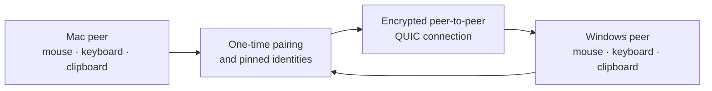

# SeamlessInput

### One mouse and keyboard. Every Mac and Windows PC on your desk.

SeamlessInput is an open-source software KVM that lets one mouse, keyboard, and
clipboard move across nearby macOS and Windows computers. It is peer to peer,
encrypted, terminal first, and designed to run without administrator access or
a cloud account.

> **Early QA preview.** The automated suite runs on Apple Silicon, Intel Mac,
> and Windows x64. Physical end-to-end behavior between a real Mac and Windows
> PC is still **NOT MEASURED**. Help us test it, but do not treat this build as
> production ready.

[Download SeamlessInput v0.1.0 QA Preview](https://github.com/lanchuske/seamless-input/releases/tag/v0.1.0)
· [Report a bug](https://github.com/lanchuske/seamless-input/issues/new/choose)
· [Share an idea](https://github.com/lanchuske/seamless-input/discussions)
· [Star the project](https://github.com/lanchuske/seamless-input)

## Download SeamlessInput v0.1.0 QA Preview

Version **v0.1.0** is the current public QA Preview. Choose one of the two
installers below.

| Computer | QA Preview download |
| --- | --- |
| Mac — Universal for Apple Silicon and Intel | [Download the universal DMG](https://github.com/lanchuske/seamless-input/releases/download/v0.1.0/SeamlessInput-v0.1.0-universal.dmg) |
| Windows — x64 | [Download the Windows installer](https://github.com/lanchuske/seamless-input/releases/download/v0.1.0/SeamlessInput-v0.1.0-windows-x64.exe) |

Checksums, provenance attestations, source archives, and older raw binaries are
on the [release page](https://github.com/lanchuske/seamless-input/releases/tag/v0.1.0).
For the current QA, use the two installers linked above.

## Why SeamlessInput

- **One continuous desk.** Push the pointer through a screen edge and keep
  typing on the other computer.
- **Mac and Windows together.** Use the same symmetric peer on every machine;
  there are no permanent server and client roles.
- **Private by design.** Input and clipboard traffic stays on your local
  network over mutually authenticated, encrypted connections.
- **No cloud account.** Discovery happens locally, with manual addressing as a
  fallback.
- **No administrator install.** SeamlessInput stays in the signed-in user's
  account and does not add a service, driver, or firewall rule.
- **Open source.** Inspect the protocol, contribute fixes, and help validate
  real hardware under the MIT license.

## What works today

| Capability | Implemented | Automated coverage | Real Mac–Windows QA |
| --- | --- | --- | --- |
| Peer discovery and manual fallback | Yes | PASS | NOT MEASURED |
| One-time pairing and pinned identities | Yes | PASS | NOT MEASURED |
| Mouse and keyboard routing | Yes | PASS | NOT MEASURED |
| Text and PNG clipboard sync | Yes | PASS | NOT MEASURED |
| Multi-display topology and cursor crossing | Yes | PASS | NOT MEASURED |
| Safe disconnect and emergency return | Yes | PASS | NOT MEASURED |
| User-only install and diagnostics | Yes | PASS | NOT MEASURED |

PASS here means automated behavior passed on the supported CI targets. It does
not substitute for a physical two-machine result. We record every hardware row
as **PASS**, **FAIL**, or **NOT MEASURED** in the
[QA evidence template](docs/qa/e2e-evidence-template.md).

## How it works

Every computer runs the same native Rust peer. Nearby machines discover each
other with mDNS or a manual LAN address. A short-lived six-word code performs a
password-authenticated pairing and pins both device identities. Later sessions
use mutual TLS over QUIC.

The terminal UI places displays left, right, above, or below each other. When
the pointer crosses a configured edge, keyboard focus follows it. Clipboard
hashing prevents loops. If a connection or permission disappears, held input is
released and control returns to the local machine.

## Try the QA Preview

1. Download the matching binary on each computer.
2. On macOS, allow the binary to run and grant Accessibility permission when
   prompted. On Windows, run it as the current user; do not elevate it.
3. Run `seamless-input doctor` on both computers.
4. Pair the computers with `seamless-input pair new` on one and
   `seamless-input pair <six-word-code>` on the other.
5. Arrange the displays with `seamless-input tui`, then start both peers with
   `seamless-input start`.
6. Record the result with the [QA template](docs/qa/e2e-evidence-template.md)
   and open a bug if anything fails.

Never paste pairing codes, clipboard contents, keys, usernames, network
addresses, or stable machine identifiers into a public issue.

## Security and privacy

SeamlessInput does not install a system service or driver, change firewall or
enterprise policy, request administrator elevation, or bypass an operating
system restriction. macOS requires explicit Accessibility permission for
global input. Windows support is limited to the current user's normal desktop;
login screens, UAC prompts, elevated apps, and other users are outside scope.

Clipboard payloads are bounded, memory only, hash deduplicated, and never
logged. Pairing codes expire and are not advertised. Suspected vulnerabilities
belong in [private vulnerability reporting](SECURITY.md), never a public issue.

## Roadmap

The core mouse, keyboard, clipboard, topology, discovery, pairing, transport,
and recovery paths are implemented. The immediate priorities are:

- universal signed and notarized macOS DMG;
- signed Windows installer with a simple first-run experience;
- physical Mac–Windows QA and compatibility evidence;
- clearer onboarding and an end-to-end demo;
- file drag and drop, mobile clients, application continuity, and optional
  pointer assistance after the core experience is proven.

Follow the [open roadmap issues](https://github.com/lanchuske/seamless-input/issues)
or join a [design discussion](https://github.com/lanchuske/seamless-input/discussions).

## Contributing

You can help without writing Rust:

- test on real Mac and Windows hardware;
- improve setup and accessibility documentation;
- report a reproducible bug with redacted diagnostics;
- propose focused product improvements;
- contribute tests, platform fixes, or small reviewed pull requests.

Read [CONTRIBUTING.md](CONTRIBUTING.md) before opening a pull request. Large
features should begin as a Discussion so scope and security boundaries are
clear. All changes go through review and the protected CI matrix.

## Documentation

- [Documentation index](docs/README.md)
- [MVP architecture and behavior](docs/architecture/mvp-specification.md)
- [Release and QA runbook](docs/qa/release-and-qa-runbook.md)
- [End-to-end QA evidence template](docs/qa/e2e-evidence-template.md)
- [Community feedback guide](docs/community/feedback.md)
- [Security policy](SECURITY.md)
- [Code of conduct](CODE_OF_CONDUCT.md)

## Frequently asked questions

### Is this like Apple Universal Control or Microsoft Mouse Without Borders?

SeamlessInput targets the same multi-computer mouse and keyboard workflow, but
it is an independent open-source project built for mixed Mac and Windows desks.
It is not affiliated with Apple or Microsoft.

### Is SeamlessInput a remote desktop app?

No. It does not stream screens, audio, or video. Each computer keeps using its
own display; SeamlessInput shares input and clipboard data only.

### Does it require administrator privileges?

No. macOS still requires the user to grant Accessibility permission. That is an
operating-system consent prompt, not an administrator installation.

### Does it work with more than two computers?

The topology and routing model supports multiple peers. The automated suite
covers multi-peer routing; mixed three-machine physical QA is still not
measured.

### Does it support Linux, iPhone, iPad, or Android?

Not yet. The current target is macOS and Windows. Mobile and broader platform
support belong to the post-QA roadmap.

## License

SeamlessInput is available under the [MIT License](LICENSE).
