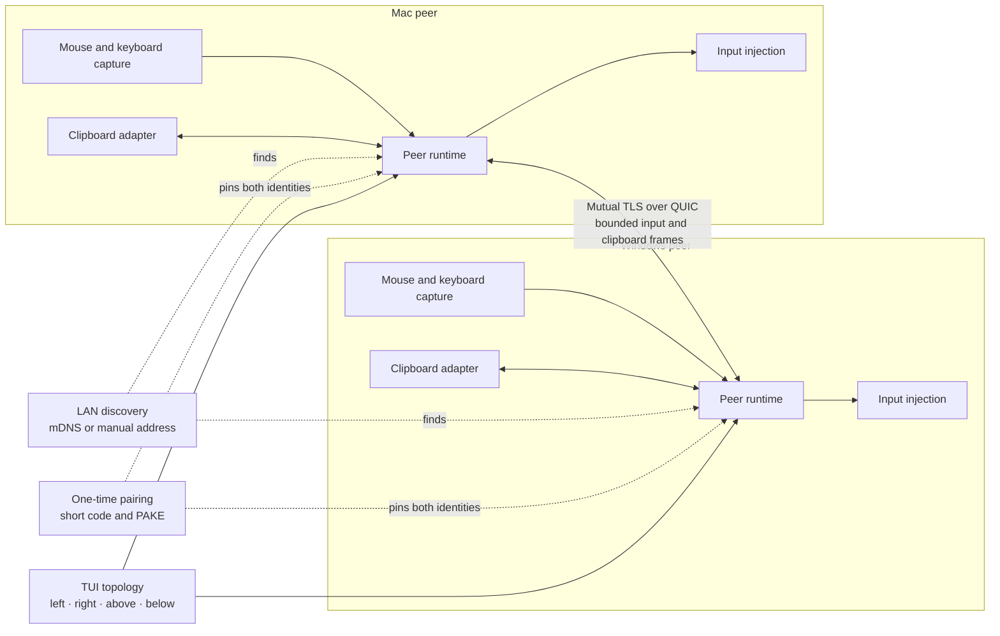

# SeamlessInput — cross-platform mouse, keyboard, and clipboard sharing

SeamlessInput is an open-source, terminal-first software KVM for sharing one
mouse, keyboard, and clipboard across nearby macOS and Windows computers. It is
designed as a lightweight, peer-to-peer alternative for people searching for
cross-platform input sharing, seamless cursor movement, and clipboard sync
without administrator privileges.

## Download the QA Preview

The first public QA preview is available from the
**[SeamlessInput v0.1.0 release page](https://github.com/lanchuske/seamless-input/releases/tag/v0.1.0)**.

| Platform | Download |
| --- | --- |
| macOS — Apple Silicon (M1, M2, M3, M4) | [Download for Apple Silicon](https://github.com/lanchuske/seamless-input/releases/download/v0.1.0/seamless-input-aarch64-apple-darwin) |
| macOS — Intel | [Download for Intel Mac](https://github.com/lanchuske/seamless-input/releases/download/v0.1.0/seamless-input-x86_64-apple-darwin) |
| Windows — x64 | [Download for Windows](https://github.com/lanchuske/seamless-input/releases/download/v0.1.0/seamless-input-x86_64-pc-windows-msvc.exe) |

> **QA preview — not a stable release.** Automated checks pass on Apple Silicon,
> Intel Mac, and Windows x64. Physical end-to-end behavior between a real Mac
> and Windows PC is still being validated. See the release page for checksums,
> provenance attestations, and the exact measured scope.

SeamlessInput is an independent project and is not affiliated with Apple or
Microsoft. It is designed as a lightweight cross-platform alternative for
workflows commonly associated with Apple Universal Control and Microsoft Mouse
Without Borders, while keeping a single purpose and a no-admin installation.

## Why this project exists

Moving between two computers should feel like moving between two monitors. You
should be able to push the pointer through an edge, continue typing on the other
machine, and copy and paste without deploying remote-desktop software, opening
an administrative installer, or changing enterprise security policies.

Existing solutions can be powerful, but they often bring permanent
client/server roles, graphical setup, privileged services, broad permissions,
or features unrelated to this simple workflow. SeamlessInput is deliberately
smaller.

## What we are building

- Seamless mouse movement between macOS and Windows screens.
- A shared keyboard that follows the active pointer.
- Bidirectional text and PNG clipboard synchronization.
- Equal peer roles: every computer runs the same program.
- Automatic peer discovery on the local network, with manual addressing as a
  fallback.
- One-time pairing with a short code and mutually verified device identities.
- A simple terminal UI for placing screens above, below, left, or right.
- One copyable installation command for macOS and one for Windows.
- Per-user installation and PATH configuration with no administrator password.
- A native Rust implementation with its own encrypted peer channel; no SSH
  dependency.

The design supports two or more Macs and Windows PCs in the same topology.

## How it works

Every computer runs the same native peer. Nearby peers discover one another on
the local network, but they exchange input only after the user pairs them with a
short-lived code. Pairing pins both device identities; subsequent sessions use a
mutually authenticated and encrypted QUIC connection.

The topology decides which display touches each edge. When the pointer crosses
a configured edge, the local peer stops applying that input locally and sends a
bounded event stream to the selected peer. Keyboard focus follows the pointer.
Clipboard updates use hashes to prevent loops. If the connection, permission,
or peer disappears, all modifiers are released and control returns locally.

The diagram shows two machines for clarity; the same identity, topology, and
routing model extends to several Mac and Windows peers.

## Security and permission model

SeamlessInput will not install a system service or driver, modify firewall or
enterprise policies, request administrator elevation, or attempt to bypass a
restriction.

macOS requires the user to grant Accessibility permission before any third-party
app can capture and inject global input. SeamlessInput will explain that request
once and degrade safely when permission is denied. Clipboard access follows the
operating system's consent model. Windows support is limited to the signed-in
user's normal desktop; login screens, UAC prompts, elevated applications, and
other users are outside the project scope.

Pairing and transport are designed around short-lived password-authenticated
pairing, pinned device identities, and mutually authenticated TLS over QUIC.
Clipboard contents and cryptographic keys must never appear in logs or feedback
reports.

## Deliberate non-goals

The MVP will not provide remote desktop, screen sharing, screenshots, general
file transfer, audio, video, mobile or Linux support, login-screen control, or
enterprise-policy evasion.

Keeping this boundary small is part of the product: contributions should make
the core experience safer, clearer, or more reliable rather than quietly add a
new product category.

## Planned experience

The intended workflow is:

1. Run one terminal installation command on each computer.
2. Start `seamless-input` on every machine.
3. Discover nearby peers and pair them with a short code.
4. Open the TUI and place each display in its physical position.
5. Move the pointer through an edge and keep working.

Exact one-line installation commands will be published only with a checksummed release.
Do not run installation commands posted in issues, comments, or unofficial
forks.

## Frequently asked questions

### Is SeamlessInput a software KVM?

Yes. It aims to provide the keyboard, video-layout, and mouse workflow commonly
associated with a software KVM, but it does not stream video or mirror screens.
Each computer continues to use its own display.

### Does it work between Mac and Windows?

That is the primary target. The same peer model is also intended to support
Mac-to-Mac, Windows-to-Windows, and mixed multi-computer layouts.

### Does it require administrator privileges?

No. Installation and runtime stay within the current user's account. macOS does
require explicit Accessibility consent for global mouse and keyboard control;
that is an operating-system permission, not an administrator installation.

### Does it use SSH or remote desktop?

No. SeamlessInput uses its own authenticated and encrypted peer connection. It
does not depend on SSH and does not provide remote desktop or screen sharing.

## Roadmap

The current implementation plan progresses through:

1. Native Rust workspace and stable CLI contract.
2. Bounded protocol, topology, discovery, pairing, and encrypted transport.
3. Terminal topology editor.
4. macOS and Windows input and clipboard adapters.
5. Failure-safe multi-peer runtime.
6. User-only installation commands, diagnostics, CI, and real-device evidence.
7. Public beta releases after independent review.

Completion is reported with evidence as **PASS**, **FAIL**, or **NOT MEASURED**.
A green unit-test suite alone is not proof that a platform interaction works on
real hardware.

## Contributing

Contributions are welcome, including:

- Reproducible bug reports.
- Tests and compatibility results from real Macs and Windows PCs.
- Documentation and accessibility improvements.
- Focused implementation pull requests within the defined scope.
- Design feedback in GitHub Discussions.

Before opening a large pull request, start a Discussion so the approach and
scope can be agreed first. Every behavior change will need tests and a short
description of its impact on permissions, networking, privacy, and supported
platforms. Pull requests do not bypass review or CI, and a feature outside the
MVP must be proposed separately rather than bundled into an unrelated change.

- [Ask a question or propose an idea](https://github.com/lanchuske/seamless-input/discussions)
- [Report a reproducible bug](https://github.com/lanchuske/seamless-input/issues)
- [Read the MVP specification](docs/specs/seamless-input-mvp.md)
- [Choose the right feedback channel](docs/feedback.md)

- [Read the contributor guide](CONTRIBUTING.md)
- [Read the security policy](SECURITY.md)
- [Use the release and QA runbook](docs/runbook.md)

## License

SeamlessInput is available under the MIT License. See [LICENSE](LICENSE).
