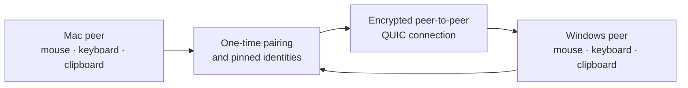

# Control Shift F12

### One mouse and keyboard. Every Mac and Windows PC on your desk.

Control Shift F12 is an open-source software KVM that lets one mouse, keyboard, and
clipboard move across nearby macOS and Windows computers. It is peer to peer,
encrypted, provides visible native first-run guidance, and is designed to run
without administrator access or a cloud account. Command-line diagnostics stay
available for advanced troubleshooting.

Press **Control + Shift + F12** on either computer to recover local control at
any time. The shortcut is also the product name, so it is easy to remember.

> **Early QA preview.** The automated suite runs on Apple Silicon, Intel Mac,
> and Windows x64. Physical end-to-end behavior between a real Mac and Windows
> PC is still **NOT MEASURED**. Help us test it, but do not treat this build as
> production ready.

[Download Control Shift F12 v0.1.1 QA Preview](https://github.com/lanchuske/control-shift-f12/releases)
· [Report a bug](https://github.com/lanchuske/control-shift-f12/issues/new/choose)
· [Share an idea](https://github.com/lanchuske/control-shift-f12/discussions)
· [Star the project](https://github.com/lanchuske/control-shift-f12)

## Download Control Shift F12 v0.1.1 QA Preview

Control Shift F12 **v0.1.1 QA Preview** is the next candidate. The durable
[Releases page](https://github.com/lanchuske/control-shift-f12/releases) always
shows the newest published preview. When v0.1.1 is published, choose one of
these two installers:

| Computer | QA Preview download |
| --- | --- |
| Mac — Universal for Apple Silicon and Intel | [Control-Shift-F12-v0.1.1-universal.dmg](https://github.com/lanchuske/control-shift-f12/releases) |
| Windows — x64 | [Control-Shift-F12-v0.1.1-windows-x64.exe](https://github.com/lanchuske/control-shift-f12/releases) |

The release workflow publishes exactly those two installers plus one
`SHA256SUMS` file. It removes obsolete downloadable assets before exposing the
preview, so testers do not have to choose between old binaries.

### Install and open it

- **Mac:** open the DMG, drag **Control Shift F12** to Applications, and open it
  there. The first-run window explains why Accessibility is needed, opens the
  correct macOS setting, and waits in safe mode until you grant permission.
- **Windows:** run the installer as your current user. The first-run window
  starts the peer visibly; the Start menu and optional desktop shortcuts open
  the product instead of exiting silently. Remove it later from **Installed
  apps**, where it appears as **Control Shift F12**.

No separate Rust, Python, driver, service, or administrator installation is
required.

## Why Control Shift F12

- **One continuous desk.** Push the pointer through a screen edge and keep
  typing on the other computer.
- **Mac and Windows together.** Use the same symmetric peer on every machine;
  there are no permanent server and client roles.
- **Private by design.** Input and clipboard traffic stays on your local
  network over mutually authenticated, encrypted connections.
- **No cloud account.** Discovery happens locally, with manual addressing as a
  fallback.
- **No administrator install.** Control Shift F12 stays in the signed-in user's
  account and does not add a service, driver, or firewall rule.
- **Open source.** Inspect the protocol, contribute fixes, and help validate
  real hardware under the MIT license.

## What works today

| Capability | Implemented | Automated coverage | Real Mac–Windows QA |
| --- | --- | --- | --- |
| Peer discovery and manual fallback | Yes | PASS | NOT MEASURED |
| One-time pairing and pinned identities | Yes | PASS | NOT MEASURED |
| Mouse and keyboard routing | Yes | PASS | NOT MEASURED |
| Text and PNG clipboard sync | Yes | PASS | NOT MEASURED |
| Multi-display topology and cursor crossing | Yes | PASS | NOT MEASURED |
| Safe disconnect and emergency return | Yes | PASS | NOT MEASURED |
| User-only install and diagnostics | Yes | PASS | NOT MEASURED |

PASS here means automated behavior passed on the supported CI targets. It does
not substitute for a physical two-machine result. We record every hardware row
as **PASS**, **FAIL**, or **NOT MEASURED** in the
[physical QA matrix](docs/qa/physical-qa-matrix.md).

## How it works

Every computer runs the same native Rust peer. Nearby machines discover each
other with mDNS or a manual LAN address. A short-lived six-word code performs a
password-authenticated pairing and pins both device identities. Later sessions
use mutual TLS over QUIC.

The terminal UI places displays left, right, above, or below each other. When
the pointer crosses a configured edge, keyboard focus follows it. Clipboard
hashing prevents loops. If a connection or permission disappears, held input is
released and control returns to the local machine.

## Try the QA Preview

1. Install and open Control Shift F12 on both computers.
2. On macOS, grant Accessibility when the first-run window opens the system
   setting. On Windows, keep the visible app running as the current user; do
   not elevate it.
3. Use the diagnostics shortcut on Windows or run `seamless-input doctor` from
   a terminal on either computer when you need detailed local diagnostics.
4. Pair the computers with `seamless-input pair new` on one and
   `seamless-input pair <six-word-code>` on the other.
5. Arrange the displays with `seamless-input tui`, then start both peers with
   `seamless-input start`.
6. Record the result with the [physical QA matrix](docs/qa/physical-qa-matrix.md)
   and open a bug if anything fails.

Never paste pairing codes, clipboard contents, keys, usernames, network
addresses, or stable machine identifiers into a public issue.

## Security and privacy

Control Shift F12 does not install a system service or driver, change firewall or
enterprise policy, request administrator elevation, or bypass an operating
system restriction. macOS requires explicit Accessibility permission for
global input. Windows support is limited to the current user's normal desktop;
login screens, UAC prompts, elevated apps, and other users are outside scope.

Clipboard payloads are bounded, memory only, hash deduplicated, and never
logged. Pairing codes expire and are not advertised. Suspected vulnerabilities
belong in [private vulnerability reporting](SECURITY.md), never a public issue.

## Roadmap

The core mouse, keyboard, clipboard, topology, discovery, pairing, transport,
and recovery paths are implemented. The immediate priorities are:

- physical verification of the signed, notarized universal macOS DMG;
- physical verification of the signed Windows installer and first-run flow;
- physical Mac–Windows QA and compatibility evidence;
- clearer onboarding and an end-to-end demo;
- file drag and drop, mobile clients, application continuity, and optional
  pointer assistance after the core experience is proven.

Follow the [open roadmap issues](https://github.com/lanchuske/control-shift-f12/issues)
or join a [design discussion](https://github.com/lanchuske/control-shift-f12/discussions).

## Contributing

You can help without writing Rust:

- test on real Mac and Windows hardware;
- improve setup and accessibility documentation;
- report a reproducible bug with redacted diagnostics;
- propose focused product improvements;
- contribute tests, platform fixes, or small reviewed pull requests.

Read [CONTRIBUTING.md](CONTRIBUTING.md) before opening a pull request. Large
features should begin as a Discussion so scope and security boundaries are
clear. All changes go through review and the protected CI matrix.

## Documentation

- [Documentation index](docs/README.md)
- [Repository layout and root-file rationale](docs/repository-layout.md)
- [MVP architecture and behavior](docs/architecture/mvp-specification.md)
- [Release and QA runbook](docs/qa/release-and-qa-runbook.md)
- [Physical QA matrix](docs/qa/physical-qa-matrix.md)
- [Community feedback guide](docs/community/feedback.md)
- [Security policy](SECURITY.md)
- [Code of conduct](CODE_OF_CONDUCT.md)

## Frequently asked questions

### Is this like Apple Universal Control or Microsoft Mouse Without Borders?

Control Shift F12 targets the same multi-computer mouse and keyboard workflow, but
it is an independent open-source project built for mixed Mac and Windows desks.
It is not affiliated with Apple or Microsoft.

### Is Control Shift F12 a remote desktop app?

No. It does not stream screens, audio, or video. Each computer keeps using its
own display; Control Shift F12 shares input and clipboard data only.

### Does it require administrator privileges?

No. macOS still requires the user to grant Accessibility permission. That is an
operating-system consent prompt, not an administrator installation.

### Does it work with more than two computers?

The topology and routing model supports multiple peers. The automated suite
covers multi-peer routing; mixed three-machine physical QA is still not
measured.

### Does it support Linux, iPhone, iPad, or Android?

Not yet. The current target is macOS and Windows. Mobile and broader platform
support belong to the post-QA roadmap.

## License

Control Shift F12 is available under the [MIT License](LICENSE).
